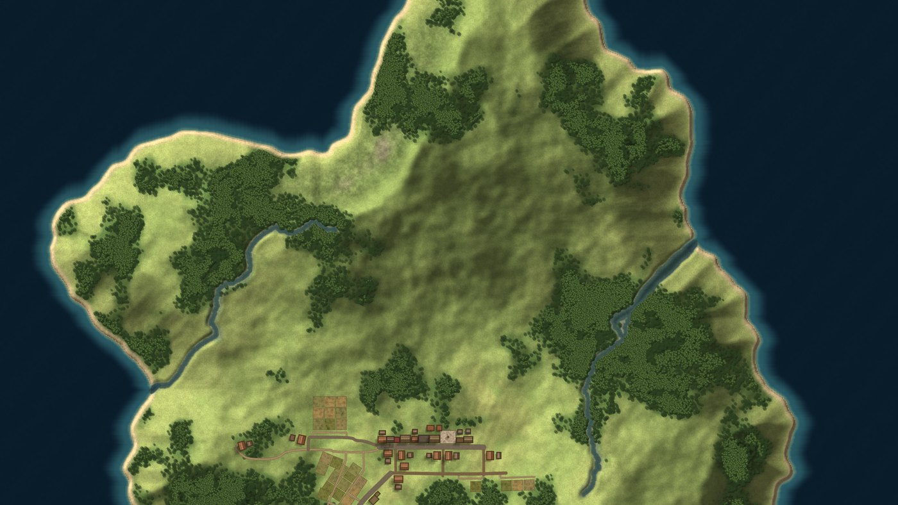
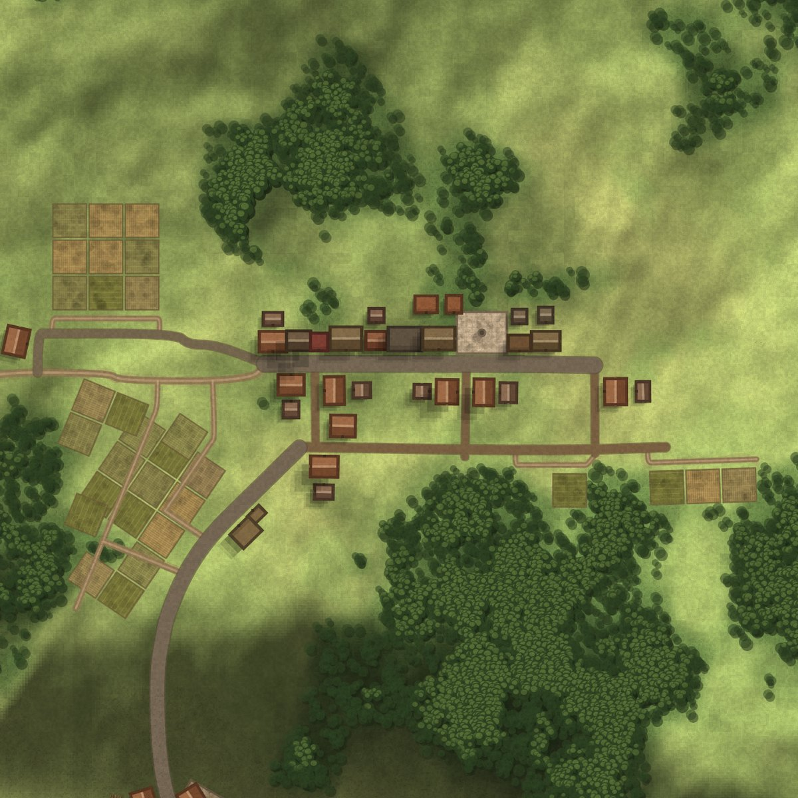
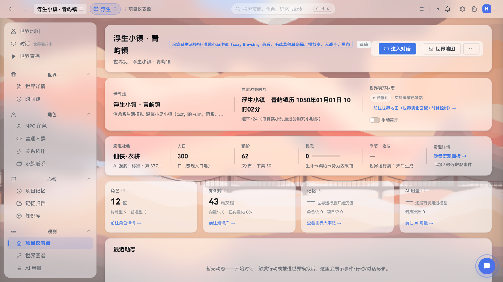
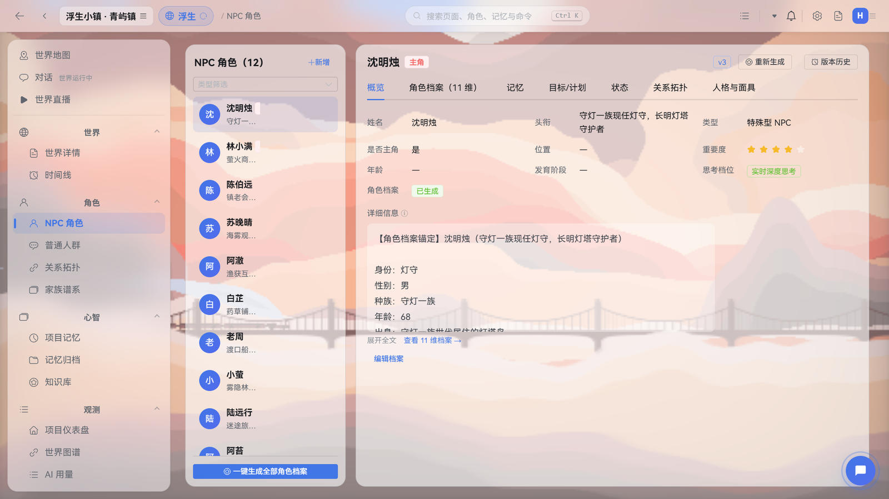
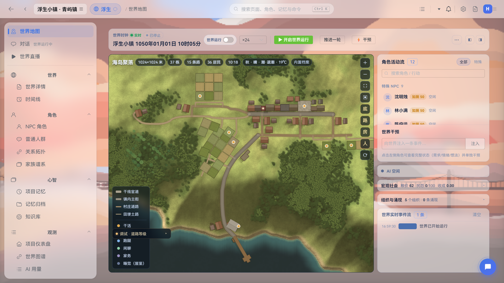
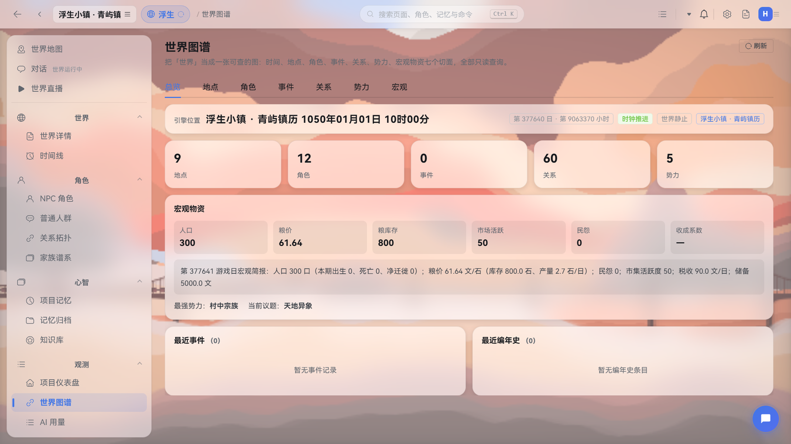
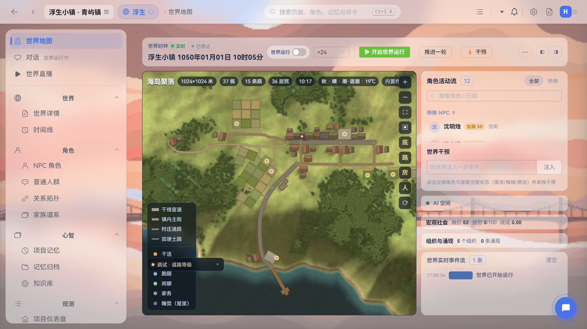

<div align="center">

# HolzynActor

### 全境众生 · 浮生

<a href="assets/brand/emblem.svg" title="HolzynActor · 全境众生 · 浮生">
  
</a>

> 「生活不是我们活过的日子，而是我们记住的日子，我们为了讲述而在记忆中重现的日子。」
> —— 加西亚·马尔克斯《活着为了讲述》
>
> *La vida no es la que uno vivió, sino la que uno recuerda y cómo la recuerda para contarla.*
>
> **「浮生若梦，而梦中的每一次相遇，都被世界记住了。」**
>
> 然后把它交给时间。时间会记住角色说过的话、走过的路、爱过的人。
> 记忆沉淀为洞察，洞察生长为故事——**你不在的时候，世界没有停笔。**


<p><b>⚠️ 使用须知</b>：<b>必须自行配置 AI 模型</b>——世界的推进、角色的决策与对话全部依赖模型调用；<br/>
程序化只作兜底，如果全按兜底走的话会非常僵，非常不真实。</p>

<p>本项目仍在开发阶段，可能存在功能缺陷，<b>请不要过度信任 AI——AI 也会出错</b>。<br/>
世界、角色都是 AI 生成的虚构内容，请勿当真。仅供研究和体验用！</p>

</div>

---

**一句话**：HolzynActor（全境众生）是一台**让世界自己活着的 AI 世界模拟引擎**——你给它一段世界观，它还你一个会自己过日子、自己记事、自己长出故事的世界。

**定位**：面向「想看到世界真的在运转的人」的世界模拟引擎。没有剧本编写，没有角色操纵。世界自行运行其时间，角色按时起居、交流传达、记录恩怨、视局势调整计划。可旁观，可发言。

**形态**：以「浮生」名义出现的世界模拟引擎，运行在你自己的电脑上——本地项目数据，没有云端账号体系，但需要**自行设置 AI 模型**方能运作。可看、可干预，也可退为纯 AI 大脑交给引擎客户端掌控实时世界。它是 Holzyn 全境世界生成体系里「角色与世界驱动」的内核，独立呈现为本仓库「全境众生 · 浮生」。

## 目录

| 分组 | 内容 |
|---|---|
| **第一次来** | [浮生之约](#浮生之约) · [核心亮点](#核心亮点) · [快速开始](#快速开始) · [常见问题](#常见问题) |
| **它会造世界** | [世界构建与生成](#世界构建与生成) · [世界运行与时间演化](#世界运行与时间演化) |
| **它会过日子** | [角色认知与记忆](#角色认知与记忆) · [角色状态与情绪](#角色状态与情绪) · [角色生命历程与人格](#角色生命历程与人格) |
| **它会成为社会** | [社会关系与群体涌现](#社会关系与群体涌现) |
| **看见它 · 接管它** | [世界沙盘与实时干预](#世界沙盘与实时干预) · [外部接入与质量保障](#外部接入与质量保障) |
| **装上它** | [桌面端](#桌面端) · [快速开始](#快速开始) · [存储与数据](#存储与数据) |
| **了解它** | [延伸阅读与研究定位](#延伸阅读与研究定位) · [开源许可](#开源许可) |

## 浮生之约

> 「浮生」二字落在这里：世界不必等你上线，但它记得你来过。五条承诺，每一条都落在已经跑通的机制上。

| 承诺 | 在 HolzynActor 里怎么兑现 |
|---|---|
| ⏳ **你不在，世界也没停笔** | 单一权威世界时钟 + 无人值守自转：世界按自己的节奏推进——角色按时作息、按计划行动、随局势改主意。桌面端可**最小化到系统托盘后台继续跑**；你也可以随时让它静止：暂停即冻结，恢复从冻结处接续，**不补算离线**。 |
| 📖 **它会记得** | 四层记忆 + 世界编年史 + 项目记忆 + 知识库：说过的话、走过的路、爱过的人都会留下。记忆随时间模糊、随睡眠清洗、随巩固升层，也会在需要时被**主动想起**。 |
| 🌱 **它会自己长大** | 全生命周期十阶段 + 人格演化 + 婚育谱系：角色从婴儿走到耄耋，重大事件会真实改变性格，结婚生子让家族树继续生长，衰老与身后事都有交代。 |
| 🏘 **它会自己长出一个社会** | 关系网络 + 群体闲谈 + 中观组织 + 宏观社会演化：消息在地理上扩散、在口耳间失真，收成影响粮价、粮价影响生计、生计影响势力。 |
| ✓ **它不会假装成功** | 统一护栏 + 兜底降级 + 独立评审 + 兜底路径验收：模型调用失败会被**降级**而不是被掩盖；世界也不会为了好看而破例。 |

## 核心亮点

- **🗺 程序化写实世界地图**——从一段世界观文字出发，先由 AI 给出「这个世界该长什么样」的地理性格与设施契约，再由确定性算法在真实地形上求地形、算路网、按契约落位、合成写实顶视地图；**同一个种子，同一座岛**，AI 挂掉也能出图（详见[世界构建与生成](#世界构建与生成)）
- **🧠 真·认知闭环**——感知 → 记忆 → 思考 → 扮演 → 行动 → 学习，由世界运行时统一编排：角色是真的「看见 → 想 → 说 / 做 → 记住 → 成长」，而不是按脚本念台词
- **🌍 活着的世界**——单一权威时钟推动世界前进，每天自动生成世界日报，季节与天气注入感知 / 对话 / 决策三条链路，消息在地理上扩散并在人群口耳间失真
- **🎭 千人千面**——每次决策都注入角色的全量个性：同一件事，稳重者组织乡老议事、勇武者上前查看、医者背起药箱、隐者按兵不动
- **👤 一生一世**——统一角色档案 + 全生命周期十阶段：角色会成长、会成家、会生养、会衰老、会离世，性格也会被经历真实地改写
- **🏛 自己长出来的社会**——收成 → 粮价 → 生计 → 势力的因果链把气候一路传导到饭桌，中观组织自发成组，二阶涌现可检测、可回放
- **🕰 会想、会犹豫、会回来**——高重要度事件先推演几种可能再动；被打断的事有记录，处理完按性格决定回去继续、改变安排还是彻底放弃
- **👁 双界面 · 看得见也说得上话**——「浮生」看世界自己运转，「对谈」让世界冻结下来、坐下来和角色慢慢聊；世界地图上可点击拾取、插话、注入事件、控时、切天气
- **🔌 可被接管**——世界也可退居为纯 AI 大脑，交给 Unity / 鸿蒙客户端主导，断开即冻结、重连从冻结处接续
- **🧪 可被检验 · 📦 项目即文件**——独立评审通道打分（一致性 / 合理性 / 情境利用 / 前瞻性 / 自然度）+ 统一护栏降级 + 兜底不崩；整个世界可导出为单个 `.holzyn` 文件，随身携带、随时还原
- **🤖 项目级 AI 助手**——任意页面 `Ctrl+Shift+A` 唤起元层助手：讲世界 / 角色 / 宏观 / 项目，叙事与事实双模式、逐项来源标注、项目文档向量检索；确认后还能替你干预世界，并解读任意一次 AI 决策链路
- **💬 对谈系统**——与任意角色真正聊起来：单聊 / 群聊（同地点清醒角色围坐一桌），SSE 流式回复、玩家档案与关系（好感 / 信任 / 阶段）、会话级世界书与长对话摘要；确认后沉淀为关系变化与 NPC 记忆，不写入世界编年史（零 OOC）
- **🖥 桌面端开箱即用**——Windows 安装版：无边框沉浸窗口、启动闪屏、托盘后台运行、安装/卸载向导，以及**自动更新**（stable / beta 双通道，更新前自动备份数据、启动失败自动恢复）。见[桌面端](#桌面端)

## 世界构建与生成

> 从一段世界观文字，到一个已经诞生、带编年史的世界。

- **三种造世界入口**：上传世界观文字交给 AI 自动分段解析；手动分节填写；或交给创意发散生成
- **工作流式世界生成**：多维 AI 工作流分工产出世界设定（部分并行、部分链式），预览确认后落库
- **一键全自动流水线**：设计角色阵容 → 逐角色深度建档 → 世界初始化 → 生成「世界诞生」编年史，全程实时进度
- **角色阵容与建档**：按世界观自动设计核心角色并逐个建档；档案可完整预设，AI 只补缺、不覆盖你写好的部分
- **故事规划与风格宪法**：生成「叙事力学」与「世界风格宪法」（语气 / 参照 / 叙事人格 / 戒律 / 题材笔记）——只定义力、不定义事件
- **项目即文件**：整个世界导出为单个 `.holzyn` 文件，可选密码加密，换机器、送人都只需一个文件

### 世界地图生成管线

> 不是让 AI 直接画一张图，而是让 AI **只决定「什么该存在」**，把「长在哪」交给确定性算法。

| 阶段 | 谁来做 | 产出 |
|---|---|---|
| **S0 世界档案** | AI | 把世界观文字里的地理性格翻成一组**可解释的地理量**（狭长度、海岸破碎度、平原占比、河流条数…），**不含任何坐标** |
| **S1 地形** | 确定性算法 | 同一种子同一座岛：噪声地形 + 水力侵蚀 + 生物群系 + 海岸内凹外凸与高程偏置 |
| **S2 建筑资产** | AI | 「这一带该有什么房子」——只给类型、尺寸倾向与作用，不给坐标 |
| **S3 路网拓扑** | AI 给拓扑、算法走线 | AI 只说「谁连谁 + 路的性格」，走线由最小代价寻路在真实地形上求 |
| **S4 落位** | 确定性算法 | 契约设施（灯塔 / 码头 / 渡口 / 广场 / 农田…）按方位硬约束与预算落位，房屋贴街、院落补齐 |
| **S5 合成** | 确定性算法 | 写实顶视地图：踩踏土、路肩描边、石板铺装、田垄分级、院墙菜畦、树冠与夜间窗火 |

<p align="center"></p>

<p align="center"></p>

- **AI 只写「意图」，算法负责「不穿帮」**：AI 写错数字最坏只是「岛的样子不太像设定」，不会出现房子盖在河里、路穿过山脊
- **AI 挂掉也能出图**：`mapgen.ai-enabled` 总开关 + 三层兜底（关闭 / 异常 / 输出无法解析）一律回落到**确定性兜底**；本地离线调参与线上兜底用同一套数据与算法，不会「本地好看、线上难看」
- **AI 输出过三道闸门**：① 大类白名单（写「军事 / 宗教」直接丢）② 禁忌清单（按名字 + 大类 + 描述比对世界观禁忌）③ 必要类型补齐（缺住人的 / 卖东西的 / 种地的就从内置库补）；尺寸 / 层数 / 权重 / 颜色全部夹到真实量纲
- **路网是「一张网」**：悬空端点吸附、碎片用最小代价补连、生成完再焊一次（田埂也纳入连通性），硬约束回归测试保证「全图只有 1 个连通分量」
- **道路有等级**：田埂 1.6~2.4 米 / 村庄 2.4~3.2 / 主街 4.0~5.5 / 官道 6.0~8.0，宽度由等级硬钳制，AI 说石板也不听——生产路一律土路
- **农田按人口给足**：田块数 = 人口 ÷ 3（落在 2:1 ~ 4:1），一出镇就是可耕地，田埂土路从村道接进田区
- **异步生成 + 实时进度**：建行 → 提交异步任务 → 立刻返回，进度按项目广播（SSE）并落库；同一项目同时只允许一个 run
- **单阶段重跑**：只重算该阶段之后的部分（S3 之后重跑不会白花 S0/S2 两次 AI 调用）
- **可复现**：同种子两次生成逐字段一致；`mapgen.ai-enabled=false` 时全确定性，便于比对与调参

## 世界运行与时间演化

> 世界不是等你来才转的，它有自己的时钟。

- **单一权威世界时钟与三周期调度**：以「现实时间 × 速率」推算游戏时间，秒级推进、暂停冻结、随时调速；感知每 5 游戏分钟、主决策每游戏小时、记忆与总结每游戏日
- **每日世界帧**：每天 0 点自动生成一份「世界日报」（逐区域天气、宏观事件、信息包、环境变化），AI 主生成 + 规则兜底双通道
- **时间与季节**：季节轮转、气温曲线、天气切换与体感温度；角色的性格参数（怕冷 / 喜雨 / 夜猫子 / 体弱 / 怕热 / 恋家 / 好动）会按环境加权
- **信息扩散与三层过滤**：消息按「距离 × 速度」在各地间传播，沿途被添油加醋地**失真**；每个角色只听到「他够得着、够格听、以他的视角」的版本
- **世界运行时语义**：启动全静止，进入沙盘（或被客户端接入）才运行该世界；暂停即时间冻结，恢复从冻结处接续、不补离线
- **编年史、世界记忆与前瞻**：世界事件沉淀为时间线，实体状态按失效规则更新；另有程序化趋势（粮价 / 民怨 / 势力 / 议题的环比方向）与一句「未来一天世界走向」注入决策
- **世界直播**：把「此刻世界正在发生什么」聚合成一页只读观测——实时事件流、角色当前行动、宏观快照、世界时钟，不进地图也能看

<p align="center"></p>

## 角色认知与记忆

> 角色不是「每小时例行做点事」，而是像人一样对世界做出即时反应。

<p align="center"></p>

- **六件套闭环**：感知（看见世界）→ 记忆（记住经历）→ 思考规划（有方向）→ 角色扮演（会说话）→ 行动（会做事）→ 学习（会成长）
- **视角化感知**：以角色自己的视角组装世界——时间、所在地、在场者、可见事件、关系摘要、自身状态，加上「他当下够得着、听得到的传闻」；八类刺激源可即时唤醒他
- **四层记忆**：工作记忆 / 经历记忆 / 核心身份 / 长期档案，按情境分层注入、按预算路由
- **记忆会变**：随时间模糊、随睡眠清洗、随巩固从低层升到高层，谱系可追溯；核心身份随经历自编辑演进
- **会主动想起，知识也会活**：需要时角色自己检索——角色记忆 + 世界大事记 + 人物知识卡三源检索，带冷却；知识会淡忘、会被标注「可能过时」，而角色的经历会沉淀成新的知识
- **双通道决策与打断**：周期通道管日常作息，即时通道管突发应对；被打断的事有记录，处理完按性格决定回去继续 / 调整 / 放弃
- **协商与弦外之音**：盯上同一件事会真去谈一次；还会按自己的性格过度解读或直接理解对方的话

## 角色状态与情绪

> 有身体、有情绪；而身体和情绪会反过来影响他做什么。

- **生理四需 + 健康 + 心情**：饥饿 / 口渴 / 精力 / 膀胱与健康值随游戏时间衰减、随行动恢复，长时间运行不吞小数
- **生理会真的打断他**：危险时实时打断，放下手头事去吃饭 / 喝水 / 如厕 / 休息；进食还有三餐窗口
- **PAD 情绪模型**：愉悦 / 唤醒 / 支配三维 + 主导情绪标签与强度；情绪会自然衰减、会写回记忆、会反向影响决策
- **紧急度与能力自评**：派生紧急度文本与 0~3 级，升档即触发即时反应；角色对自己各领域的能力有主观评分（允许自信，也允许谦逊），偏差本身就是性格
- **社交差异化**：对恩人、旧识、猜忌者的态度有分寸，关系随经历实时变化并反过来影响行为
- **可观察、可调参**：状态历史曲线、实时调参面板

## 角色生命历程与人格

> 角色不是一个固定的设定文本，而是一段被预设、又会被经历改写的人生。

- **统一角色档案**：身份与社会 / 外貌与体质 / 生理基线 / 气质与人格 / 价值观与动机 / 能力与知识 / 语言与表达（声音指纹）/ 习惯与日常 / 经历与创伤 / 发育·遗传·谱系 / 社会面具
- **全生命周期十阶段**：婴儿 → 幼儿 → 学龄 → 青少年 → 青年 → 壮年 → 中年 → 老年 → 耄耋 → 已故，每阶段有明确的能力门控与行为约束
- **此刻可发生空间**：程序化硬门控 + AI 软可能性空间（此刻内心 / 可发生状态 / 可发生行为 / 不可发生）——决策必须落在空间内，护栏校验兜底
- **人格演化**：重大事件驱动人格受控偏移，偏移速率与幅度受发育阶段约束，全程留证据链可反查
- **社会面具**：内心与表达分离，对权威 / 伴侣 / 陌生人 / 同伴 / 子女 / 仇怨对象 / 公共 / 私人各有抑制强度；面具会破绽——酒精、创伤触发物会让最不该失态的人失态
- **遗传、婚育与谱系**：基因位点重组 + 表观修饰 + 噪声与突变；角色可恋爱、结婚、生育，新生儿档案按家族与时代环境自主生成
- **衰老与死亡**：机能曲线随龄衰减、感官退化、疾病风险上升；自然死亡（调试期可关）与身后事——编年史、丧亲记忆、遗产转移
- **认知 LOD**：按「观察强度」而不是「角色总数」分配算力——远离视线且无人相关的角色走轻量路径，一旦被靠近、被涉及或与被关注者相关，就自动升档为完整决策

## 社会关系与群体涌现

> 个体之上还有一整个世界在跑：收成会一路传导到每个村民的饭桌上。

- **关系与好感**：关系类型 / 好感 / 信任 / 关系状态随对话、行动、事件三挂钩实时演化，拓扑可视化
- **群聊与自主对话**：单聊、群聊，以及角色之间自己找话题闲聊、回应彼此——对话结束后自动抽取记忆并影响双向关系
- **与角色对谈**：你也能直接和角色聊起来——单聊、群聊（与冻结时刻同地点的清醒角色围坐一桌），角色基于当时的世界状态、记忆与关系真实回应；对话结果经你确认后沉淀为关系变化与 NPC 记忆，对谈本身不写入世界编年史
- **家族谱系与中观组织**：婚育与继承形成可追溯的家族树；势力、归属、自发成组三类群体自动派生，例行指令与事件指令会注入成员感知
- **宏观社会演化**：人口 / 经济 / 势力的数值引擎 + 文化舆论与科技推进；**收成 → 粮价 → 生计 → 势力**的因果链把气候变化一路传导到饭桌
- **双向联动与行为多样性**：宏观影响个体、个体行动回流宏观；状态涟漪 + 日衰减避免所有人都做同一件事
- **二阶涌现检测与全链路回放**：防自举聚合 + 权重 / 冷却 / 比例控制 + AI 叙事回退；一次宏观推进的输入 / 参数 / 事件 / 回灌四跳可回放

## 世界沙盘与实时干预

> 你可以只是看着，也可以伸手推一把。

<p align="center"></p>

- **2D 写实世界地图**：项目默认落地页。AI 生成的真实感地图与「角色活动流 + 世界演化」双主角并置——家园、道路、区域、角色实时位置与动态一览无余
- **地图交互**：缩放 / 平移、图层开关（道路等级 / 建筑 / 姓名 / 住所 / 角色）、点击拾取——点角色看状态与关系，点建筑看位置与用途
- **实时通道**：角色的位置、动作、想法实时流动，时钟条实时跳动，世界动态即时广播
- **干预手段**：插话（角色会真的回应）、触发行动、注入事件、控制时间与倍速、切换天气
- **世界图谱**：把「世界」当成一张可查的图——时间 / 地点 / 角色 / 事件 / 关系 / 势力 / 宏观七个只读切面，全部可查询
- **决策链路可回看**：一次决策的「感知 → 思考 → 行动 → 学习」完整链路可逐环节打开，AI 调用详情结构化呈现
- **可观测性**：用量看板、漂移度量、数据巡检、护栏与路由、Prompt 工程指标——世界为什么这么做，有据可查

<p align="center"></p>

## 外部接入与质量保障

> 它可以是世界本身，也可以是别人世界背后的大脑。

- **引擎接管**：HolzynActor 可退居为纯 AI 大脑，把实时世界交给 Unity 客户端主导——统一消息契约、心跳看门狗、序号幂等对账、断线重连续传
- **客户端拨钟**：客户端上报游戏时刻驱动世界推进；断开即世界冻结，重连从冻结处接续、**不补离线**
- **上报即感知**：玩家视野与交互作为新的刺激源，角色会因此被打断、改变计划
- **环境与坐标**：客户端上报的天气环境就地生效并联动环境刺激；客户端格子坐标与服务端语义位置双向换算（1 格 = 0.2 米）
- **原生鸿蒙端**：ArkTS + ArkUI + 本地数据库，业务与数据 100% 本地化 → [HolzynActor_HarmonyOS](https://github.com/hongyun1312/HolzynActor_HarmonyOS)
- **可被检验**：行为质量由**独立评审通道**按五维打分（一致性 / 合理性 / 情境利用 / 前瞻性 / 自然度），样本去标识、位置打散，避免自己评自己
- **不会假装成功，也不会停摆**：空输出、复读机、连续失败、超时统一拦在护栏里并降级到兜底路径——模型不可用时世界不会崩、不会假装成功，但**会明显变得僵硬**；这条兜底路径有专门验收守住
- **世界时间不丢、决策不造假**：世界时间用 tick 队列推进，超出容量的流逝显式记账、绝不静默丢弃；每次决策都打来源标（AI / 重试 / 程序化兜底 / 预算耗尽）——失败不伪造「在驻地歇息」这类假活动
- **测试与长跑**：三千余条单元 / 回归测试 + 多轮真实长跑（跨自然日、跨小时边界、断线重连）逐轮抓缺陷并留下可复现证据

## 桌面端

> 不是把网页塞进一个壳，而是按桌面应用的方式活：秒开、常驻、自己升级。

<p align="center"></p>

- **无边框沉浸窗口**：每次打开固定 16:9 的 1280 × 720 窗口，自绘最小化 / 最大化 / 关闭三键，侧栏默认展开——小屏幕上也不挤
- **启动闪屏**：点开就到，不再「点了之后干等」——闪屏随后端启动信号推进，显示「正在校验世界数据库… / 正在装载 AI 意识层… / 世界已就绪」；失败时闪屏内直接给「打开日志目录 / 重试 / 退出」，重试会清掉残留进程
- **托盘后台运行**：关闭窗口默认最小化到系统托盘，**世界继续在后台推进**；托盘菜单「退出」才真正结束（退出前优雅停后端、数据库干净落盘）。也可在设置里改成「关闭即退出」
- **自动更新**：内置更新器（GitHub Releases，stable / beta 双通道）——发现新版 → 确认 → 自动备份数据 → 优雅退出 → 静默升级 → 重启；**更新前自动备份、启动失败自动恢复**，世界数据零丢失
- **安装 / 卸载向导**：中文安装向导（可选创建桌面 / 开始菜单快捷方式）、安装实时日志、Windows「设置 → 应用和功能」里的卸载入口（卸载时可选是否一并删除本地数据，默认保留）
- **数据落在本机**：数据库、世界、上传资源都在本机用户目录；便携版不受安装目录限制
- **跨平台说明**：安装包面向 Windows；源码可在 macOS / Linux 以 `bash run.sh` 运行（桌面壳当前只打包 Windows 目标）

## 快速开始

**方式一：安装包**

1. 到 [Releases](https://github.com/hongyun1312/HolzynActor/releases) 下载最新安装包，按向导安装
2. 首次启动会带你完成本地账户 → **配置一个模型接口**（OpenAI 兼容 API 或本地模型）→ 我的形象
3. 项目画廊里已经躺着一个示例世界「**浮生小镇 · 青屿镇**」，点进去就能看到它自己运转

**方式二：跑源码**

前置：**JDK 21** 与 **Node.js 20+**（Windows 另需 Maven，或直接使用仓库内 `run.bat` 的引导）

```bash
git clone https://github.com/hongyun1312/HolzynActor.git HolzynActor && cd HolzynActor
run.bat            # Windows（macOS / Linux：bash run.sh）
# 然后打开 http://localhost:18080
```

- 首次启动会引导你建立本地账户；进入项目画廊即可新建项目，或直接打开随库内置的示例世界
- **进入设置配置一个模型接口**（OpenAI 兼容 API 或本地模型）——这是让世界正常运转的前提，不配模型只能看到僵硬的兜底状态，详见[常见问题](#常见问题)
- 世界默认**启动全静止**：进入世界地图（或由引擎客户端接入）后该世界才开始运行，其余世界保持静止
- 只想要干净的前后端分离开发：后端 `mvn -o spring-boot:run`（默认 18080）、前端 `npm run dev`（默认 5174，已配 `/api` 代理）
- 打包：`build.bat` / `build.sh` 产出后端 jar；桌面端打包见 `desktop/README.md`（`npm run pack`）

<p align="center"></p>

## 存储与数据

项目数据默认存在本机 `data/` 目录（可用环境变量 `HOLOZYN_ACTOR_DATA_DIR` 重定向），本地单机部署无需外部存储。

| 路径 | 内容 | 增长预期 | 自动治理 |
|---|---|---|---|
| `data/holzyn-actor.mv.db` | H2 主库：世界 / 角色 / 记忆 / 对谈 / 地图 / 用量 | 随世界规模与对谈增长；**AI 调用日志是最大来源** | 见下「AI 调用日志滚动保留」 |
| `data/ai-call-logs/` | AI 调用详情 JSON 副本（供人工排查） | 每次 AI 调用 1 个文件，与调用日志同增 | **随 DB 行一起滚动保留**（默认 7 天） |
| `data/vector-store/` | 向量库 embedding 文件（`<project>/embeddings.json`） | 随知识库规模增长 | 不自动清理（重启时从库内 embedding 列重新导入） |
| `data/worldmap/` | 世界地图产物（写实底图 / 地形贴图缓存） | 每个世界一份 | 随世界删除 |
| `uploads/` | 上传资产（头像 / 沙盘场景资产等） | 随资产导入增长 | 不自动清理 |
| `logs/` | 运行日志 | 随运行时间增长 | 手动清理 |

**AI 调用日志滚动保留**：`actor_ai_call_log`（含 `data/ai-call-logs/` 文件副本）默认只保留 **7 天**，由后台定时任务（默认每 6 小时一次，启动后立即执行一次）滚动删除超期数据。可用环境变量调整（`days=0` 表示关闭滚动删除）：

- `HOLOZYN_ACTOR_DEBUG_AI_LOG_RETENTION_DAYS`：保留天数（默认 `7`）
- `HOLOZYN_ACTOR_DEBUG_AI_LOG_RETENTION_ENABLED`：滚动保留总开关（默认 `true`）
- `HOLOZYN_ACTOR_DEBUG_AI_LOG_RETENTION_INTERVAL_MS`：定时维护间隔毫秒（默认 `21600000` = 6 小时）

> 说明：对谈消息、世界、角色、记忆等**用户内容永不自动删除**；数据库 schema 由 Flyway 迁移统一管理（升级不丢数据）。

## 常见问题

<details>
<summary><b>需要联网吗？我的数据会被传到哪去？</b></summary>

**必须配置 AI 模型才能正常使用。** 世界的流转、角色的选择对话、世界的设定生成、记忆/知识检索…**全部依赖模型调用**——这里的模型可以是本地自部署的，也可以是云端 API。调用的模型性能越好、速度越快，世界越真实、越流畅。

**程序化只是最后手段，而不是使用方式。** 不配模型时世界不会崩，但那是一种退化状态：角色会退回机械的作息循环，行动僵硬、对话空洞，**非常不真实**。它的唯一目的是模型抖动或失败时不把世界搞坏。想要「像真人一样生活」的世界，必须要上模型。

数据方面：项目数据（世界观 / 角色 / 记忆 / 对话 / 地图）默认都存在你自己的电脑上。项目自身没有云端账号体系；只有你自己配置的模型接口会收到为生成内容而发送的提示词。
</details>

<details>
<summary><b>我关掉之后，世界会乱吗？</b></summary>

不会。你暂停就是时间停止，恢复就是从停止的地方继续，**没有补算下线**。世界停转期间，所有内存蒸馏、批量巩固、档案清理等后台工作统统不执行，不会有「回来一看过了一百年」的情况。

桌面端关闭窗口默认只是**最小化到托盘**——世界仍在后台按你的设定继续走；想彻底停就在托盘菜单「退出」，或改用「关闭即退出」。
</details>

<details>
<summary><b>角色做得不像人 / AI 出错了怎么办？</b></summary>

系统有三道保险：统一护栏（空输出、复读、连续失败、超时都会被拦下并降级）、兜底降级（模型失败时角色仍有一个不崩的默认行为，但会显得僵硬）、独立评审（由另一条通道给行为质量打分，自己评自己会失真）。当然，本项目仍在开发中，**请不要过度信任 AI**。
</details>

<details>
<summary><b>能只跑一个小村子吗？规模可以多大？</b></summary>

目前主要在村庄 / 小镇级别打磨：随库内置的「浮生小镇 · 青屿镇」是 1024 × 1024 米、44 栋建筑、18 条道路的岛镇，12 位有名有姓的角色加普通居民，长期用作验收世界。规模可以继续放大，但角色越多、决策越密，对算力和时间的要求越高；大规模世界请谨慎运行。
</details>

<details>
<summary><b>这是游戏吗？我能做什么？</b></summary>

不是传统意义上的游戏，而是一台**可看、可干预、可接管**的世界模拟引擎：你可以旁观它自己运行，可以走进去说一句话、推一件事件，也可以把实时世界交给引擎客户端去渲染和主导。
</details>

<details>
<summary><b>世界地图是 AI 画的吗？会不会每次都不一样？</b></summary>

世界地图是**程序化生成**的：AI 只负责「这个世界该有什么地理性格、该有哪些设施」，坐标与几何全部由确定性算法在真实地形上求解。因此**同一个种子能得到同一座岛**；只有新造世界时 AI 给出的契约不同，岛才会不同。想完全离线复现，可关闭 `mapgen.ai-enabled`，走纯确定性兜底。
</details>

## 延伸阅读与研究定位

HolzynActor 的设计与实现借鉴了大量已有研究与工程实践——记忆与反思、情绪与需求、人格与发展、社会演化与涌现、可复现的实验方法，都在项目里留下了痕迹。

完整的「借鉴与参考来源」清单（每条注明出处链接，以及**我们从它借鉴了哪个理念或理论**）见 → [**HolzynActor 理论参考与借鉴来源**](docs/HolzynActor_理论参考与借鉴来源_V1.0.md)

我们也承认当前技术的边界：最新研究直言「语言流畅不等于行为效度」，并把 LLM 社会模拟的困局概括为 **从微观到宏观的有效性缺口**（[From the Fluency Fallacy to the Micro-to-Macro Validity Gap, arXiv:2507.19364](https://arxiv.org/abs/2507.19364)）；也有大量工作提醒「仅靠 LLM 智能体还不足以支撑社会模拟」。这正是本项目把**程序化兜底、可验证性、可复现**当作一等公民的原因——我们更愿意让世界跑得久、跑得住、跑得清，而不是只跑得漂亮。

## 开源许可

本项目采用 **Apache License 2.0** 开源发布。

- 版权：Copyright (c) 2026 HONGYUN
- 完整许可文本见 [LICENSE](LICENSE)，版权归属与第三方依赖声明见 [NOTICE](NOTICE) 与 [THIRD_PARTY_NOTICES](THIRD_PARTY_NOTICES.md)
- 任何使用、修改与分发均须保留版权与许可证声明；修改文件须注明变更
- 本项目仅供学习与研究用途，按「AS IS」提供，不附带任何明示或默示担保；AI 输出内容由模型生成，不代表作者立场

<div align="center">
<b>浮生若梦，而梦中的每一次相遇，都被世界记住了。</b><br/>
然后把它交给时间。
</div>
